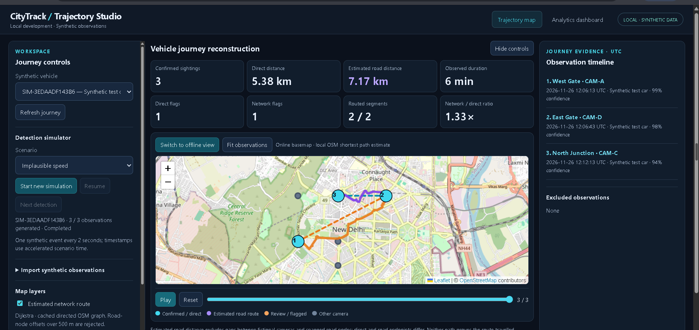

# CityTrack — Trajectory Studio

Local educational computer-vision and GIS prototype for anonymous, single-recording traffic analysis and synthetic route reconstruction. Runs on localhost with SQLite; no Firebase account required.



## Features

- Detect vehicle categories with YOLO and track temporary IDs using ByteTrack within a single recorded clip.
- Export normalized image-plane motion samples to local CSV and SQLite, with interactive replay and aggregate traffic summaries.
- Visualize image-coordinate trails, an illustrative highway schematic and a clearly labelled simulated geographic view.
- Reconstruct estimated routes between **fictional** camera observations using Dijkstra and a cached directed OpenStreetMap driving graph.
- Evaluate reconstruction on known fictional graph fixtures and produce synthetic scenario reports.

The two data flows are deliberately separate: video coordinates are not GPS, and the geographic demo does not identify or locate real vehicles. Track fragments may split or switch; they are not unique vehicle counts. The prototype does not implement plate recognition, real geographic video localization, cross-camera matching, future location prediction, or live production deployment.

## Quick start (Windows / PowerShell)

Use Python 3.12 (the demonstrated version). From the extracted project folder:

```powershell
python -m venv .venv
.\.venv\Scripts\python.exe citytrack_final.py --test
```

Tests require no third-party packages or footage. To run the full application for the first time, download the demo graph (internet required):

```powershell
.\.venv\Scripts\python.exe -m pip install -r requirements.txt
.\.venv\Scripts\python.exe trajectory_osm.py --download-osm
.\.venv\Scripts\python.exe citytrack_final.py
```

The synthetic SQLite database is created on startup. Keep the terminal running, then open [http://127.0.0.1:8002/](http://127.0.0.1:8002/). The optional online street basemap requires internet; route calculations use the local graph. If port 8002 is occupied, stop the old server or add `--port 8003` and use that port in the URLs. `--check` reports missing optional demo data as well as source modules, so it need not pass in a fresh checkout before data preparation.

## Video workflow

Use only footage you are authorized to process for this experiment. No source footage, real movement datasets, or model weights are included. To generate local results from your own authorized clip, run the following once (first inference may download YOLO weights):

```powershell
.\.venv\Scripts\python.exe citytrack_video.py highway.webm --seconds 60 --out video_full_results
```

Place the authorized clip in the project folder first. The output folder must not already exist. If you already have a report, copy it locally into `video_full_results` or pass `--report path/to/video_map.html` to the launcher. Video pages show a missing-report message until results exist; the synthetic trajectory and analytics pages work independently. To test the interface with fabricated samples instead, run `python demo_video_fixture.py` (standard library only). Do not use the synthetic fixture as measured footage. For video preview, choose the matching original clip in the browser; the clip stays local.

| Page | URL path |
| --- | --- |
| Synthetic trajectory map | `/` |
| Synthetic analytics | `/analytics` |
| Video image-plane trajectories | `/video` |
| Simulated geographic video display | `/video-map` |
| Highway Studio | `/highway` |

## Reports and tests

```powershell
python citytrack_final.py --test
python citytrack_final.py --evaluation
python citytrack_final.py --reports
python citytrack_final.py --traffic-report
```

Use the virtual environment interpreter for these commands if you created it. Evaluation creates `citytrack_evaluation.html`; synthetic reports are in `reports/`; traffic report files are in `traffic_report/`. Choose a new `--out` folder for repeated aggregate report runs. The synthetic reports command needs the cached OSM graph; the standalone `python citytrack_reports.py` uses a fictional graph without a download.

## Demonstrated results (one prior local experiment)

The 60-second highway recording produced 353 track fragments and 10,587 samples (not verified distinct vehicles). The controlled six-fixture route evaluation routed 5/6 cases, exactly matched 4/6, and reported 84% mean directed-edge overlap and 4.21% mean absolute distance error across routed fixtures. These are controlled benchmark metrics, not real-world accuracy estimates. The automated suite contains 86 tests. See `docs/VALIDATION.md` for release checks and limitations.

## Source layout

`citytrack_final.py` is the entry point. `citytrack_highway.py`, `citytrack_video_geo.py`, `citytrack_video_studio.py` and `citytrack_studio_fixed.py` implement local dashboard views. `citytrack_video.py` handles anonymous single-clip motion extraction. `trajectory_osm.py` and `trajectory_analytics.py` implement synthetic routing and analytics. The remaining modules provide the unified backend, evaluation, reports and synthetic contract tests.

## Credits, rights and responsible use

The original [CityTrack repository](https://github.com/kaushik-negi/CityTrack) inspired the project. Its original ANPR source directory and assets are not included here. This release does not claim direct ANPR integration or endorsement by the original authors.

- [Ultralytics YOLO licensing](https://www.ultralytics.com/license): AGPL-3.0 or applicable commercial terms. Review obligations before redistribution; the proposed public-source licence is AGPL-3.0, subject to the publisher confirming rights and adopting it.
- Map data © [OpenStreetMap contributors](https://www.openstreetmap.org/copyright), ODbL. Preserve attribution; review tile usage rules before any hosted deployment.
- [Leaflet](https://leafletjs.com/) and [OSMnx](https://osmnx.readthedocs.io/) are used by the map workflow. Their own licences apply.

This is a release candidate, not a public licence grant. See `docs/PUBLICATION.md` before making the repository public. Use anonymous single-clip analysis and synthetic inputs; keep footage, local databases, credentials and generated individual motion records private. No real vehicle identities or locations are inferred by the prototype.
