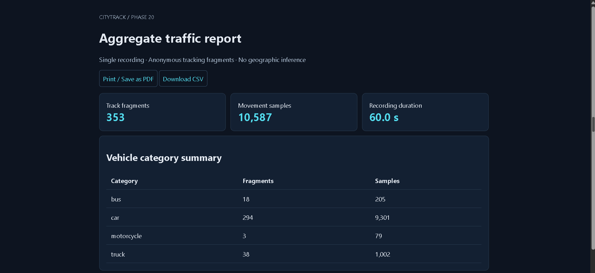

# Full highway video demonstration

This guide reproduces the local, anonymous single-recording traffic experiment in CityTrack Trajectory Studio. The small built-in fixture is only a smoke test; it is not the original highway recording or the measured results.

## Reference experiment

One previously completed run analyzed 60 seconds of highway footage with YOLO and ByteTrack, recording 10,587 movement samples across 353 temporary track fragments.

| Model category | Track fragments | Movement samples |
| --- | ---: | ---: |
| Car | 294 | 9,301 |
| Truck | 38 | 1,002 |
| Bus | 18 | 205 |
| Motorcycle | 3 | 79 |
| **Total** | **353** | **10,587** |



These counts are not independently verified unique vehicles or classification accuracy. They are a record of one local experiment, not a guaranteed result of another run.

Reference footage: [Cars in Highway Traffic (FREE STOCK VIDEO)](https://www.youtube.com/watch?v=zOq2XdwHGT0). This is a source link, not a redistribution licence. Verify the creator's terms and use footage you are authorized to process. The original recording, individual motion records and model weights are not distributed here. A different authorized traffic clip can also be used.

## 1. Install from GitHub (Windows PowerShell)

Run from a directory where the clone destination does not exist:

```powershell
git clone https://github.com/kaushik-negi/CityTrack.git CityTrack-demo
cd CityTrack-demo\trajectory_studio
python -m venv .venv
$py = ".\.venv\Scripts\python.exe"
& $py -m pip install -r requirements.txt
& $py citytrack_final.py --test
& $py trajectory_osm.py --download-osm
```

Python 3.12 is the demonstrated version. Initial installation, graph download and model download require internet access. The local road graph is for the separate synthetic route demonstration; it is not a calibration of the highway clip. If graph preparation fails, resolve that error before launching Studio. `Test-Path .\citytrack_osm_network.json` should return `True` after successful graph preparation.

## 2. Process a recording locally

Place an authorized recording named `highway.webm` in `trajectory_studio` (or change the filename below). Use a new output directory to preserve any existing demo or real results. The processing command refuses to overwrite an existing output directory.

```powershell
& $py citytrack_video.py highway.webm --probe
& $py citytrack_video.py highway.webm --seconds 60 --stride 2 --out video_full_results_real
```

The first inference may download model weights. This produces a local HTML movement report, CSV observations and SQLite database. If the small fixture already exists in `video_full_results`, leave it untouched. The new report is selected explicitly below. Do not run `demo_video_fixture.py` to reproduce the measured experiment.

## 3. Open the five dashboards

```powershell
& $py citytrack_final.py --report video_full_results_real/video_map.html
```

Keep that terminal running. In the browser, open:

| Dashboard | Address |
| --- | --- |
| Synthetic geographic route reconstruction | http://127.0.0.1:8002/ |
| Synthetic analytics | http://127.0.0.1:8002/analytics |
| Video movement trails | http://127.0.0.1:8002/video |
| Simulated geographic video view | http://127.0.0.1:8002/video-map |
| Highway Studio | http://127.0.0.1:8002/highway |

Highway Studio: select the matching original local clip in the optional preview, adjust the category and minimum-sample filters, choose recent trails and press Play. Preview and trails use elapsed recording time. The clip is not uploaded by the preview control. The geographic video display is illustrative placement, not GPS, and the road schematic is not calibrated.

If localhost refuses the connection, check the server terminal for startup errors. If port 8002 is occupied, stop the old server or launch with `--port 8003` and substitute 8003 in each address.

## 4. Generate the aggregate report

From a second terminal in `trajectory_studio`:

```powershell
.\.venv\Scripts\python.exe citytrack_final.py --traffic-report --report video_full_results_real/video_map.html --out traffic_report_real
start traffic_report_real\traffic_summary.html
```

Choose a new report output directory if that one already exists. The aggregate report includes category totals, sample counts and duration, without individual identities or movement histories.

## 5. Reuse existing results instead of processing again

If you already have a trusted local `video_map.html` generated by this prototype, pass its path to `citytrack_final.py --report`. Keep the original matching footage local for optional playback. There is no need to replace or regenerate that report.

## Reproducibility and publication limits

- Exact tracking counts depend on the recording, model weights, dependencies and processing configuration. Dependency ranges are not a lockfile, and the original environment's full version manifest is not available.
- Track IDs are temporary within a single recording. No number-plate recognition, cross-camera identity matching, real geographic localization or future trajectory prediction is provided.
- The reference screenshot contains aggregate statistics only. Do not commit raw footage, generated movement reports, local databases, credentials, cached map data or model weights.
- See the existing project documentation for licensing and OpenStreetMap attribution. The reference footage's redistribution rights have not been verified.
